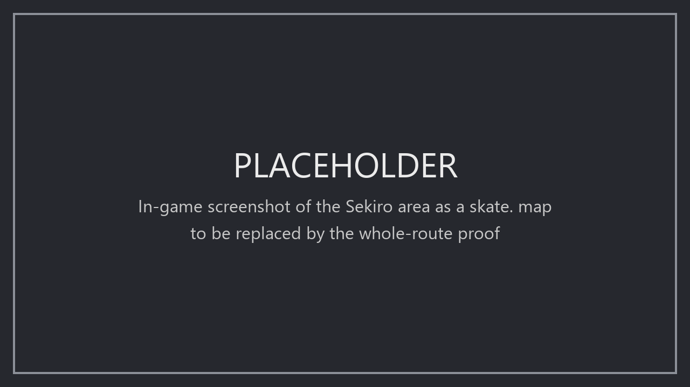

# primase

A Rust library for reading, transforming and writing 3D game worlds. It brings supported source data into a shared
`World`, so adding a reader or writer expands the possible conversions without a separate exporter for every pair.

```text
read → World (shared + namespaced data) → selected passes → write → later stages
```

Readers read supported source information faithfully; they do not bake it for a destination. Passes select and
transform that information. Writers encode prepared data they support, report what they omit, and reject invalid
data that prevents valid output. Compilation, stitching and other later stages remain explicit operations.

## Architecture

| Layer | What belongs here |
| --- | --- |
| [`core`](core/) | Shared meanings: geometry, materials, lights, collision and world state; the `World` store and pass/conversion machinery. |
| [`toolkit`](toolkit/) | Reusable mechanisms such as compression, texture processing and mesh operations, independent of a particular game or destination. |
| [`formats`](formats/) | Interchange formats and their readers, passes and writers. |
| [`worlds`](worlds/) | Game, engine-family and destination knowledge: source readers, namespaced data and domain passes/writers. |
| [`cli`](cli/) | A small command line for trying readers, passes and writers together. |

A game crate may depend on its engine's crate, never the reverse. Each worlds crate names only its own game,
engine or destination. Reusable destination preparation belongs alongside that destination's writer, as separately
selected passes. Complete conversion programs live in consumer repositories and own their recipes and choices.

## What this means

- **You choose what gets produced.** Region, world state, quality, baking, collision generation and placement are
  program choices. Library operations can still have sensible, documented algorithm defaults.
- **One read can feed different destinations.** Supported information stays in core or a source namespace until
  selected passes transform it. Writers do not need to know which reader supplied it; coverage determines what can transfer.
- **Losses are visible.** Reports retain known approximations, exclusions and unsupported output, including per-part
  details. Preserving meaning matters; matching an old tool's encoded bytes is not a general requirement.
- **New code has a home.** Shared concepts go in core, neutral mechanisms in toolkit, domain knowledge in formats
  or worlds, and recipe choices in the consuming program. A standard shared concept need not wait for a second reader.

## Using the library

A consumer builds the passes it chooses through their typed constructors and supplies its reader, writer and
explicit pipeline. This small sketch chooses to turn curves into polylines with a 1 cm tolerance; a real route also
selects its source and destination preparation passes.

```rust
use primase_core::convert::{convert, ConvertReport, Reader, Result, Writer};
use primase_core::pass::{PassManager, PassRegistry, Pipeline};
use primase_meshops::FlattenCurves;

fn export(reader: &mut dyn Reader, writer: Box<dyn Writer>) -> Result<ConvertReport> {
    let passes = Pipeline {
        passes: vec![Box::new(FlattenCurves::new(0.01)?)],
    };
    let select = Pipeline::default(); // No selection: retain all read content.
    // A registry names passes for pipelines written as text; a pipeline built from typed passes needs none.
    let manager = PassManager::new(PassRegistry::new());
    convert(reader, writer, &manager, &select, &passes)
}
```

Inspect the returned report's `notices()`; failures expose a partial report through `ConvertError`.
Use `convert_parts` for incremental loading with explicit partition planning, or compose library operations directly.

## From a Sekiro area to a skate. map



*Placeholder: the in-game screenshot comes with the whole-route proof.*

One program, five stages:

- **Read.** `AreaReader` reads an area of Sekiro as the game stores it: placements, models, materials and their
  layered shaders, lights, spawn points and collision. It decides nothing for a destination; what has no shared
  meaning stays in the `fromsoft` namespace.
- **Select.** Passes run once on the world as read and lower Sekiro's data to core meanings: collision by hit class,
  static meshes posed, the finest level of detail, layered materials baked to plain textures, materials, lights and
  spawn points.
- **Prepare.** Passes run on each part before it is written and prepare it for skate.: textures sampled at the
  albedo's tiling (the dialect has no texture transform), raised to the skate dialect, clipped to the region, the
  floor placed, the spawn chosen, water, the pause map, textures capped and tinted, decal overlays stacked, blend
  chains ordered and budgeted, the collision laid out.
- **Write.** `MapSink` encodes the prepared part as a map folder for ReSkate Studio. What it leaves out or
  approximates is a notice in the report; a value it cannot encode is an error.
- **Compile.** `compile_map` runs ReSkate Studio on the folder, with every compile choice stated, into a playable mod.

`convert` drives the first four: it reads, runs the selection, loads the region, runs its preparation, checks it
against what the writer writes, and writes it. This region is one part; a larger map is converted in parts
(`convert_parts`) and written as the whole map would be. Every choice is a typed value, an enum or a checked number, so a choice that is not valid fails while the pipeline is built, before
anything is read.

<!-- quoted from cli/examples/sekiro_to_reskate.rs: keep the two the same -->
```rust
fn main() -> Result<()> {
    // Ashina Castle (m11_01), the part within [west, south, east, north] metres, and placements reaching 30 m into it
    let region = [-170.0, 180.0, -50.0, 300.0];
    let oodle = load_oodle(Path::new("C:/Games/Sekiro/oo2core_6_win64.dll"))?;
    let decoder = Decoder { oodle: Some(&oodle), max_output: 1 << 30 };
    let options = sekiro::Options { region: Some(region), region_margin: 30.0, ..Default::default() };
    let mut reader = AreaReader::new("C:/Games/Sekiro", "m11_01", decoder, options);
    let e = EncodingOptions {
        out_root: "out".into(),
        name: Some("ashina".into()),
        max_render_edge: Some(48.0),
        ..EncodingOptions::default()
    };

    // Run once on the area as read: Sekiro's own data lowered to core meanings.
    let (reach, water, leave_out) = (Some(Metres::new(50.0)?), HitClass::set([22, 36])?, HitClass::set([29, 40])?);
    let hit_filters = HitFilters::new([8, 27])?;
    let skip = [SkipClass::Sky, SkipClass::LightVolume, SkipClass::Shadow].into();
    #[rustfmt::skip]
    let lower = Pipeline {
        passes: vec![
            Box::new(LowerFromSoftCollision { hit_filters, water: water.clone(), leave_out: leave_out.clone(), reach }),
            Box::new(LowerFromSoftObjectCollision { convex: ConvexBodies::Tessellate, leave_out: &water | &leave_out,
                leave_out_motion: [2].into(), convex_surface: ConvexSurface::Render, reach }),
            Box::new(DropFromSoftFar),
            Box::new(ApplyRigidSkinning),
            Box::new(LowerFromSoftGeometry { pose: Pose::Rigid, uv_tiling: Tiling::Apply, winding: Winding::Normals,
                degenerates: Degenerates::Drop, leave_out: skip, blocker_cards: Cards::Record }),
            Box::new(SelectLod { choice: LodChoice::Finest }),
            Box::new(BakeFromSoftLayers::new(PixelCap::new(512)?, Seconds::new(0.0)?)),
            Box::new(LowerFromSoftMaterials::new(None)),
            Box::new(LowerFromSoftLights::new(Factor::new(1.0)?, Fraction::new(0.15)?).with_min_range(Metres::new(0.5)?)),
            Box::new(LowerFromSoftExtras),
        ],
    };

    // Run on each part before it is written: the core world prepared as the ReSkate writer encodes it.
    let prepare = Pipeline {
        passes: vec![
            Box::new(NormalizeNormals),
            Box::new(DropFromSoftTextureTransforms::new()),
            Box::new(RaiseSkate::new(RaiseOptions::new("ashina", LightCalibration::Standard)?)),
            Box::new(ClipReskateRegion::new(region, 30.0)?),
            Box::new(PrepareReskateFloor::new(100.0, 250.0)?),
            Box::new(PrepareReskateGrinds::studio()),
            Box::new(PlaceReskateSpawn::centre()),
            Box::new(SnapReskateMarkers::for_encoding(&e)?),
            Box::new(PrepareReskateWater::new(WaterExtent::Region { margin: 400.0 }, OceanMaterials::Stated)?),
            Box::new(PrepareReskatePauseMap::new(PauseSource::Geometry { height: 2160, extent: PauseExtent::Region })?),
            Box::new(CapTextures::new(256)?.with_mode(CapMode { normals: NormalDownscale::Box, ..CapMode::default() })),
            Box::new(PrepareReskateTextures),
            Box::new(PrepareReskateUvRepeats::new(RepeatDecals::Omit, RepeatBlended::Cutout)),
            Box::new(PrepareReskateOverlays::new(0.004)?.for_encoding(&e)?),
            Box::new(PrepareReskateBlendOrder::new(200.0)?.for_encoding(&e)?),
            Box::new(PrepareReskateCollision::new(CollisionSurfaces::Coalesce, CollisionWeld::Millimetre, &e)?),
            Box::new(SummarizeReskateMap::for_encoding(&e)?),
            Box::new(PlanReskateBlendBudget::pool()),
        ],
    };

    // Read, lower, prepare, write `out/ashina`; what was left out or approximated comes back as notices.
    let writer = Box::new(MapSink::new(Path::new(""), &e));
    let report = convert(&mut reader, writer, &PassManager::new(PassRegistry::new()), &lower, &prepare)?;
    for notice in report.notices() {
        println!("{notice}");
    }

    // ReSkate Studio compiles the map folder into a mod.
    let studio = Studio { cli: "C:/ReSkate/reskate_cli.exe".into(), game: "C:/Games/skate".into() };
    let choices = CompileChoices {
        streaming: Some(Streaming::Cells),
        lods: true,
        gi: true,
        time_of_day: Some(TimeOfDay::Noon),
        pause_map: None,
    };
    let compiled = compile_map(&studio, Path::new("out/ashina"), Path::new("out/staging"), "ashina", &choices)?;
    println!("{} ({} warnings)", compiled.patch.display(), compiled.warnings);
    Ok(())
}
```

This is [`cli/examples/sekiro_to_reskate.rs`](cli/examples/sekiro_to_reskate.rs) without its imports and Oodle
loader; `cargo test --workspace` builds it. With the game, ReSkate Studio and skate. installed at the paths in it:

```text
cargo run --release -p primase-cli --example sekiro_to_reskate
```

The screenshot is a complete program's output: these passes and the program's own, for what it chooses beyond the
library: ledges chained into grind rails, travel markers named for players with the spawn among them, collision
added where the game has none under a rendered surface, foliage drawn as plain surfaces, and markers snapped down to
the ground.

Status: the library is being aligned with this model; remaining boundary exceptions are tracked in
[`architecture.toml`](architecture.toml).

See [CONTRIBUTING](CONTRIBUTING.md) for rules, checks and real-data setup, and [DESIGN](docs/DESIGN.md) for detail.

[GPL-3.0-or-later](LICENSE)
